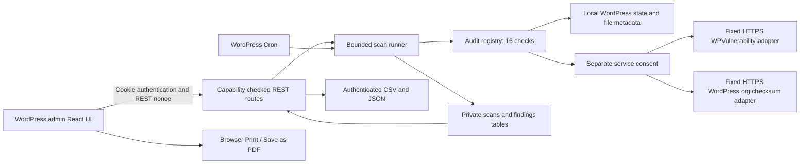

# Architecture

`site-security-auditor.php` uses a local namespace autoloader; the installed plugin needs no Composer runtime. `Plugin` registers lifecycle hooks, the admin page, REST routes and scheduled work. `ScanRunner` serialises starts and workers using atomic database locks, stores deterministic finding identities, and advances a persistent check cursor. No browser POST polling loop runs work automatically.

The database stores versioned score results at scan completion. Export and report views read stored results rather than rerunning checks. Optional integrations consult current consent for each batch. Unavailable evidence remains unknown. `ScanDiff` uses stable component/advisory identities and refuses to resolve findings when the relevant assessment is unavailable.

Development dependencies and TypeScript sources are excluded from the runtime archive. The release builder includes compiled local assets and their WordPress dependency metadata. See `PROGRESS.md` for the verified matrix and remaining limitations.
